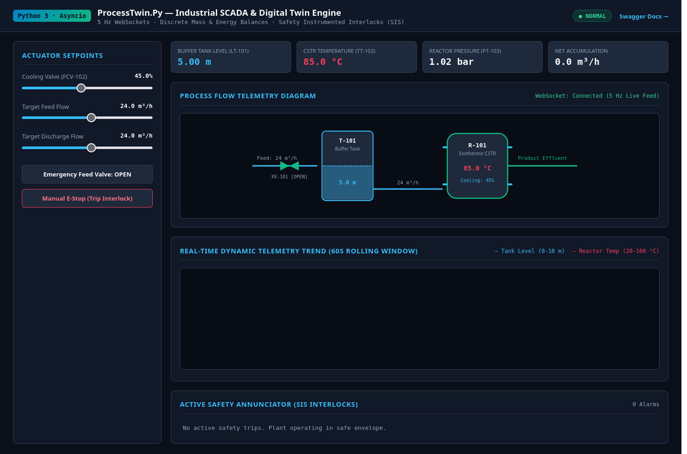
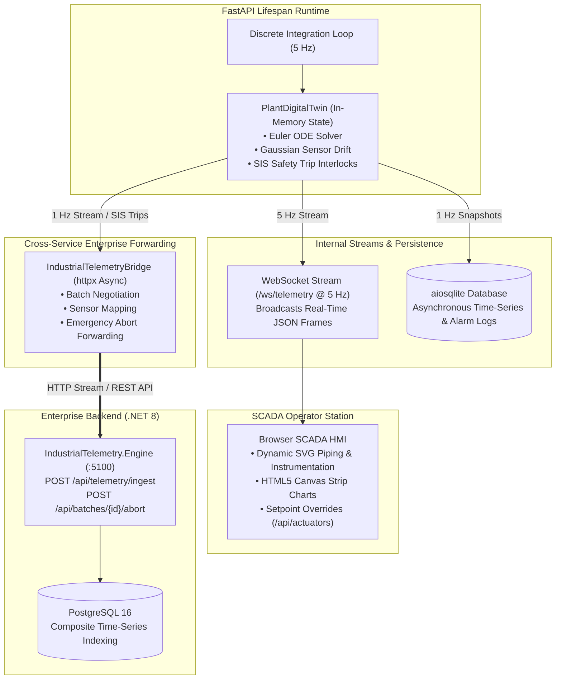
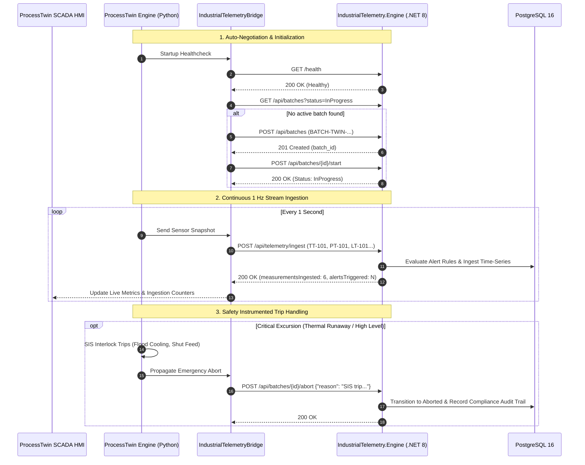

# ProcessTwin.Py — Industrial Process Digital Twin & Real-Time SCADA Engine

[](https://github.com/yancsalmeida/ProcessTwin.Py/actions/workflows/python-ci.yml)
[](https://www.python.org/)
[](https://fastapi.tiangolo.com)
[](https://docs.python.org/3/library/asyncio.html)
[](https://github.com/yancsalmeida/IndustrialTelemetry.Engine)
[](docker-compose.yml)
[](LICENSE)

An asynchronous, event-driven industrial Digital Twin simulating a coupled chemical buffer tank and continuous exothermic stirred-tank reactor (CSTR). Engineered with **FastAPI**, **Asyncio**, **Pydantic v2**, and **aiosqlite**, `ProcessTwin.Py` streams real-time sensor telemetry at 5 Hz over WebSockets, enforces automated Safety Instrumented System (SIS) interlocks, logs time-series data asynchronously, and serves an interactive dark-mode SCADA dashboard.



---

## Technical Highlights

- **Event-Driven Asynchronous Runtime:** Built on Python's `asyncio` event loop and FastAPI `lifespan` background tasks, executing continuous 5 Hz discrete integration without blocking incoming HTTP requests or WebSocket broadcasts.
- **Enterprise .NET 8 Telemetry Bridge:** Continuous 1 Hz asynchronous forwarder transmitting sensor snapshots to [**`IndustrialTelemetry.Engine`**](https://github.com/yancsalmeida/IndustrialTelemetry.Engine), managing batch lifecycles (`Scheduled` $\to$ `InProgress` $\to$ `Completed`/`Aborted`), automated batch negotiation, and propagating SIS emergency trip aborts into PostgreSQL 16.
- **Physical & Thermodynamic Rigor:** Coupled mass and non-linear dynamic energy balances modeling buffer surge dynamics, Arrhenius reaction kinetics, cooling jacket heat exchange, and Antoine vapor pressure approximation.
- **Transmitter Noise Emulation:** Injects Gaussian white noise ($\mathcal{N}(0, \sigma^2)$) on level, temperature, and pressure signals to emulate real-world 4–20 mA industrial transmitter sensor drift.
- **Safety Instrumented Systems (SIS / IEC 61511):** Continuous automated evaluation of safety interlocks (HAZOP trip conditions). Automatically halts feed flow ($XV-101$) and floods cooling jackets upon critical level accumulation or thermal runaway.
- **Non-Blocking Time-Series Persistence:** Asynchronous parameter-safe SQLite storage via `aiosqlite`, archiving plant snapshots and annunciated alarm audit logs with indexed timestamps.
- **Live SCADA Operator Interface:** Responsive zero-dependency browser HMI with dynamic SVG piping and instrumentation rendering, Canvas strip charts, alarm annunciators, and supervisory setpoint override controls.

---

## Process Physics & Mathematical Formulation

```
 [ Feed Inflow ] ---> [ XV-101 ] ---> [ Buffer Tank T-101 ] ---> [ Exothermic CSTR R-101 ] ---> [ Effluent ]
                                            (Level h)                    (Temp T, Press P)
                                                                               |
                                                                         [ Cooling Jacket ]
```

### 1. Buffer Tank Mass Balance
Assuming constant liquid density $\rho$:
$$\frac{dh}{dt} = \frac{F_{\text{in}} - F_{\text{out}}}{A_{\text{tank}}}$$
where $h(t)$ is the liquid level ($m$), $A_{\text{tank}} = 5.0\,m^2$ is the vessel cross-sectional area, and $F_{\text{in}}, F_{\text{out}}$ are volumetric flow rates ($m^3/h$).

### 2. Exothermic CSTR Thermal Energy Balance
$$\frac{dT}{dt} = \dot{Q}_{\text{gen}} + \dot{Q}_{\text{feed}} - \dot{Q}_{\text{cooling}}$$

- **Arrhenius Reaction Heat Release:**
  $$\dot{Q}_{\text{gen}} = \dot{Q}_0 \cdot \exp\left( - \frac{E_a}{R} \left( \frac{1}{T + 273.15} - \frac{1}{T_{\text{ref}}} \right) \right)$$
- **Feed Sensible Heat Inflow:**
  $$\dot{Q}_{\text{feed}} = \frac{F_{\text{out}}}{V_{\text{rx}} \cdot 3600} \cdot (T_{\text{feed}} - T)$$
- **Cooling Jacket Heat Removal:**
  $$\dot{Q}_{\text{cooling}} = \left( \frac{\alpha_{\text{valve}}}{100} \right) \cdot k_{\text{jacket}} \cdot (T - T_{\text{coolant}})$$

### 3. Vapor Pressure & Overpressure (Antoine Relation)
The headspace pressure is governed by inert blanketing plus the saturated solvent vapor pressure:
$$P_{\text{total}} = P_{\text{atm}} + \exp\left( A - \frac{B}{T + C} \right)$$
Thermal runaways cause exponential boiling and vessel overpressure, triggering emergency venting trips.

### 4. Safety Instrumented Interlock Matrix

| Sensor Tag | Parameter | Warning Threshold | Critical Trip (Interlock Action) |
|---|---|---|---|
| **LT-101** | Tank Level | $\ge 8.0\,\text{m}$ (Warning) | $\ge 9.5\,\text{m}$ $\implies$ **Emergency Feed Shutoff ($XV-101$ Closed)** |
| **TT-102** | Reactor Temp | $\ge 115.0\,^\circ\text{C}$ (Warning) | $\ge 135.0\,^\circ\text{C}$ $\implies$ **Feed Shutoff + 100% Cooling Flood** |
| **PT-103** | Reactor Pressure | $\ge 4.0\,\text{bar}$ (Warning) | $\ge 5.5\,\text{bar}$ $\implies$ **Critical Overpressure Annunciation** |

---

## Architecture & Data Flow



---

## 🌐 Enterprise .NET 8 Telemetry Bridge (.NET 8 + PostgreSQL 16)

`ProcessTwin.Py` features a built-in asynchronous client bridge ([`telemetry_bridge.py`](src/process_twin/core/telemetry_bridge.py)) that connects this physical plant simulator with the enterprise-grade [**`IndustrialTelemetry.Engine`**](https://github.com/yancsalmeida/IndustrialTelemetry.Engine) microservice:



### Bridge REST Endpoints in ProcessTwin:
| Method | Endpoint | Description |
|---|---|---|
| `GET` | `/api/bridge/status` | Real-time connectivity, active batch metadata, and transmission metrics |
| `POST` | `/api/bridge/toggle` | Enables or pauses background streaming to the .NET engine |
| `POST` | `/api/bridge/batch/new` | Forces the creation and start of a fresh batch session in .NET Engine |
| `POST` | `/api/bridge/batch/complete` | Completes active batch in .NET Engine and returns compliance analytics |
| `GET` | `/api/bridge/batch/summary` | Fetches batch analytics summary from .NET Engine |

---

## Project Structure

```
ProcessTwin.Py/
├── .github/
│   └── workflows/
│       └── python-ci.yml           # Multi-Python CI matrix (3.11, 3.12)
├── docs/
│   └── scada_dashboard_preview.png # Live SCADA interface screenshot
├── src/
│   └── process_twin/
│       ├── __init__.py
│       ├── api/
│       │   ├── __init__.py
│       │   └── app.py              # FastAPI app, lifespan tasks, WebSockets & REST
│       ├── core/
│       │   ├── __init__.py
│       │   ├── models.py           # Pydantic v2 schemas & domain enums
│       │   ├── alarms.py           # Threshold rules & SIS interlock evaluator
│       │   ├── simulator.py        # PlantDigitalTwin Euler integrator & state machine
│       │   └── telemetry_bridge.py # Asynchronous .NET 8 IndustrialTelemetry client
│       ├── db/
│       │   ├── __init__.py
│       │   └── storage.py          # Asynchronous SQLite time-series storage
│       └── static/
│           └── index.html          # SCADA HMI (SVG PFD, Canvas trend, Setpoints & Bridge)
├── tests/
│   ├── __init__.py
│   ├── test_models.py              # Pydantic schema validation & bounds tests
│   ├── test_alarms.py              # HAZOP warning and trip logic tests
│   ├── test_simulator.py           # Mass/energy balances & automated shutdown tests
│   ├── test_storage.py             # Async SQLite CRUD & index tests
│   ├── test_api.py                 # REST endpoints and WebSocket integration tests
│   └── test_bridge.py              # .NET Bridge client & endpoint integration tests
├── Dockerfile                      # Production slim image with uv packaging
├── docker-compose.yml              # Multi-network container orchestration
├── pyproject.toml                  # PEP 621 packaging and pytest configuration
└── README.md
```

---

## Quickstart

### Option 1: Run with Docker Compose (Recommended)

Requires only [Docker](https://docs.docker.com/get-docker/):

```bash
docker compose up --build
```

- **Interactive SCADA Dashboard:** [http://localhost:8000](http://localhost:8000)
- **OpenAPI / Swagger UI:** [http://localhost:8000/docs](http://localhost:8000/docs)

### Option 2: Run with Native Python / `uv`

Prerequisites: Python `>= 3.10` and [`uv`](https://github.com/astral-sh/uv) (or standard `pip`):

```bash
# Clone repository
git clone https://github.com/yancsalmeida/ProcessTwin.Py.git
cd ProcessTwin.Py

# Install dependencies in virtual environment
uv sync --all-extras --dev

# Run server with live reload
uv run uvicorn process_twin.api.app:app --host 127.0.0.1 --port 8000 --reload
```

### 3. Run the Test Suite

```bash
uv run pytest -v
```

All 33 unit, integration, and WebSocket tests pass cleanly:
```text
tests/test_alarms.py::test_normal_operating_conditions PASSED
tests/test_alarms.py::test_level_high_warning PASSED
tests/test_alarms.py::test_level_critical_interlock_trip PASSED
tests/test_alarms.py::test_temperature_warning_and_runaway PASSED
tests/test_alarms.py::test_pressure_overpressure_alarms PASSED
tests/test_api.py::test_get_dashboard PASSED
tests/test_api.py::test_get_current_telemetry PASSED
tests/test_api.py::test_override_actuators PASSED
tests/test_api.py::test_alarms_endpoints PASSED
tests/test_api.py::test_websocket_telemetry_stream PASSED
tests/test_bridge.py::test_bridge_status_model_defaults PASSED
tests/test_bridge.py::test_bridge_check_health_success PASSED
tests/test_bridge.py::test_bridge_check_health_failure PASSED
tests/test_bridge.py::test_bridge_ensure_active_batch_existing PASSED
tests/test_bridge.py::test_bridge_ensure_active_batch_creates_new_if_none PASSED
tests/test_bridge.py::test_bridge_send_frame_payload_structure PASSED
tests/test_bridge.py::test_bridge_abort_batch_on_interlock PASSED
tests/test_bridge.py::test_api_bridge_endpoints PASSED
tests/test_models.py::test_plant_telemetry_valid PASSED
tests/test_models.py::test_plant_telemetry_invalid_level PASSED
tests/test_models.py::test_actuator_command_validation PASSED
tests/test_models.py::test_alarm_event_creation PASSED
tests/test_simulator.py::test_simulator_initial_state PASSED
tests/test_simulator.py::test_mass_balance_accumulation PASSED
tests/test_simulator.py::test_mass_balance_depletion PASSED
tests/test_simulator.py::test_automated_interlock_trip_on_high_level PASSED
tests/test_simulator.py::test_automated_interlock_trip_on_thermal_runaway PASSED
tests/test_simulator.py::test_alarm_acknowledgment PASSED
tests/test_storage.py::test_insert_and_retrieve_telemetry PASSED
tests/test_storage.py::test_insert_and_retrieve_alarms PASSED

======================== 33 passed in 0.51s =========================
```

---

## API Specification

### Plant Telemetry & Supervisory Control
| Method | Endpoint | Description |
|---|---|---|
| `GET` | `/` | Serves the interactive SCADA Operator Dashboard |
| `GET` | `/docs` | Interactive Swagger / OpenAPI documentation |
| `GET` | `/api/telemetry/current` | Returns instantaneous snapshot of plant sensors |
| `GET` | `/api/telemetry/history?limit=60` | Retrieves chronological historical telemetry from SQLite |
| `POST` | `/api/actuators` | Applies operator supervisory overrides (cooling valve, feed flow) |
| `POST` | `/api/simulation/reset` | Resets plant to initial steady-state conditions (85°C) |
| `GET` | `/api/alarms` | Lists active annunciated alarms and safety trip states |
| `POST` | `/api/alarms/{id}/acknowledge` | Acknowledges an active safety alarm |
| `WS` | `/ws/telemetry` | Real-time 5 Hz WebSocket feed streaming JSON telemetry |

### Enterprise .NET 8 Telemetry Bridge
| Method | Endpoint | Description |
|---|---|---|
| `GET` | `/api/bridge/status` | Real-time connectivity and transmission metrics |
| `POST` | `/api/bridge/toggle` | Enables or pauses streaming to the .NET engine |
| `POST` | `/api/bridge/batch/new` | Forces initiation of a new batch session in .NET Engine |
| `POST` | `/api/bridge/batch/complete` | Completes active batch and returns compliance summary |
| `GET` | `/api/bridge/batch/summary` | Fetches batch analytics summary from .NET Engine |

---

## About the Author

Developed by **Yan Almeida**, Chemical Engineer (BSc from Budapest University of Technology and Economics / BME, Technical Diploma from IFRJ) currently based in Porto, Portugal, transitioning into **Software Engineering / Backend Systems**.

This project demonstrates proficiency in:
- Modern Python (3.11+, typed async/await, Pydantic v2).
- Real-time communications (WebSockets at 5 Hz, concurrent client broadcasting).
- Distributed systems integration (continuous HTTP streaming, batch lifecycle management, automated safety interlock propagation to .NET 8).
- High-integrity backend design (Safety Instrumented Systems, automated interlocks, non-blocking asynchronous databases).
- Applied computational engineering (discrete numerical balances, differential equations, dynamic state estimation).

Connect on [LinkedIn](https://www.linkedin.com/in/yancsa/) or explore more projects on [GitHub](https://github.com/yancsalmeida).
